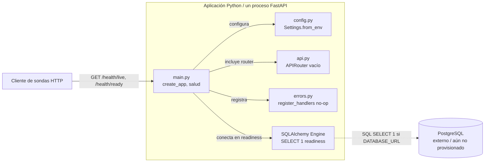

# Contenedores y módulos — arquitectura implementada (COM-02)

«Contenedor» designa una unidad ejecutable C4, no una imagen Docker: **solo hay una aplicación Python** en el código y ninguna imagen construida en este incremento. El engine SQLAlchemy está en su proceso; PostgreSQL, si se configura, es externo. Líneas continuas: composición y llamadas existentes. Línea discontinua: dependencia condicional sin instancia provisionada aquí.

| Módulo | Existe hoy | Responsabilidad y exclusión |
|---|---|---|
| `main.py` | Sí | Composición FastAPI, estado de settings/engine, sondas. No valida eventos ni crea tablas. |
| `config.py` | Sí | Lee tres variables del entorno. No incrusta credenciales; oculta los campos de su representación. |
| `contracts.py` | Sí | Declara `DuplicateEvent`, `StorageUnavailable`, `EventNotFound` y base `EventServiceError`; todavía no hay flujos de negocio que las lancen. No determina HTTP. |
| `api.py` | Stub | Exporta `router: APIRouter`; COM-01 incorporará los endpoints. |
| `errors.py` | Stub | Exporta `register_handlers(app: FastAPI) -> None`; COM-04 implementará el mapeo público. La respuesta `503` de readiness es local a `main.py` por ahora. |
| `service.py`, `schemas.py`, `auth.py`, `storage.py`, Alembic | No | Responsabilidades futuras COM-01/04/05/03; no son nodos activos del diagrama. |

## Contratos entre límites

| Interacción | Contrato en este commit | Contrato MVP de integración (aún no implementado) |
|---|---|---|
| Cliente → API salud | `GET /health/live`: `200 {"status":"alive"}`. `GET /health/ready`: `200 {"status":"ready"}` tras `SELECT 1`, o `503` con `error.code=DEPENDENCY_UNAVAILABLE`, mensaje seguro y `request_id`. Son públicas. | Mantener las sondas independientes de autenticación. |
| Config → engine | `Settings.from_env(environ: Mapping[str,str] | None = None)` devuelve `database_url: str | None` y claves `SecretStr | None`. `create_app(settings: Settings | None = None)` expone `app.state.settings` y `app.state.engine` (`None` sin URL). | Autenticación debe fallar cerrada sin claves; persistencia debe usar el engine o coordinar uno único. |
| Negocio → persistencia | Solo tipos semánticos en `contracts.py`; no existe repositorio todavía. | `events`: UUID, `source`, `external_id`, `type`, `occurred_at`, `ingested_at`, `payload`; unicidad `(source, external_id)`. SQL transaccional sin reintentos automáticos de escritura; COM-03 implementa migraciones y almacenamiento. |
| Productor/analista → API | No hay operaciones del dominio hoy: `api.router` está vacío. | `POST /v1/events` (`producer`, `201`/`409`), `GET /v1/events/{id}` (`analyst`, `200`/`404`), `GET /v1/analysis/counts` (`analyst`, `200`) con ventana `[from,to)` y `group_by=type|source`. Errores públicos `422/404/409/503/401/403`. |

**Dato → autoridad:** COM-01 será dueño lógico de eventos y agregaciones; COM-03 custodiará la tabla `events`, COM-05 leerá claves proporcionadas por el operador, y COM-04 mapeará fallos semánticos a HTTP. En este commit no hay tabla, eventos ni agregaciones almacenados. **Temporalidad objetivo:** fechas UTC y resultado agregado derivado/ordenado por clave; queda pendiente de pruebas de aceptación. No hay cola, mensajes ni jobs asíncronos. Véanse [ADR-0001](../adr/0001-descomposicion.md), [ADR-0002](../adr/0002-almacenamiento.md) y [ADR-0003](../adr/0003-comunicacion.md).
