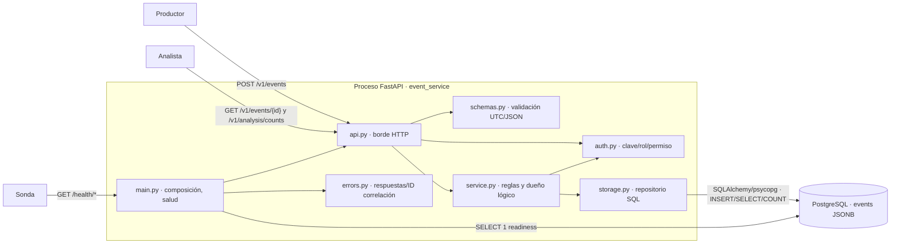

# Contenedores y módulos — MVP local (COM-02)

Una **aplicación Python** y un **PostgreSQL 16** son las dos unidades ejecutables locales. No hay imagen construida ni clúster en estos PRs. Dentro de la aplicación los módulos separan responsabilidades sin introducir microservicios.

| Módulo | Responsabilidad y límite |
|---|---|
| `main.py`, `config.py` | Compone aplicación, configura desde entorno y expone liveness/readiness; no decide reglas de negocio. |
| `api.py`, `schemas.py` | Traduce HTTP y valida estructura, tamaños, fechas y ventanas; no accede directamente a la base. |
| `service.py`, `contracts.py` | Autoridad lógica de creación/lectura/análisis; aplica permisos, mapea ausencia y usa el contrato del repositorio. |
| `auth.py` | Valida claves y roles provisionales tanto en la ruta como en el servicio; sin claves configuradas falla cerrado. |
| `storage.py`, `alembic/` | Único escritor/lector físico de la tabla `events`; migración y restricción única; no almacena agregados derivados. |
| `errors.py` | Mapea errores semánticos a HTTP público y `X-Request-ID`, sin filtrar payload o DSN. |

**Contratos verificables:** `POST /v1/events`→201 o 409/422/503; `GET /v1/events/{id}`→200/404/503; `GET /v1/analysis/counts`→200 con `total`, ventana y buckets ordenados; rutas protegidas→401/403; salud pública→200 o readiness 503. `EventRepository.create/get/counts` se comprueba con PostgreSQL real; los servicios verifican permisos antes de invocar el repositorio. La tabla y sus índices están versionados con Alembic. Véanse la [matriz regla→test](../escenario.md), [acceso](acceso.md), [errores](errores.md) y [persistencia](persistencia.md).
