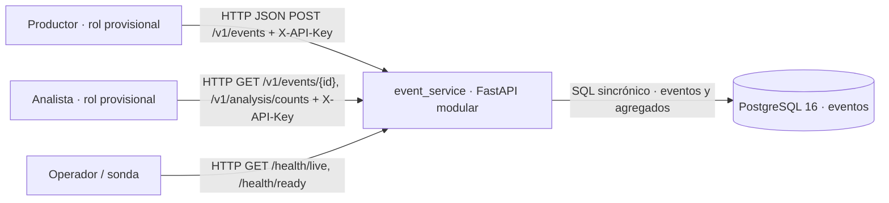

# Contexto — MVP local implementado (COM-02)

**Estado (2026-10-21):** código y pruebas locales de ingesta/análisis disponibles; **no** se ha desplegado en Azure/K3s. `producer` y `analyst` son roles elegidos para el MVP. Flechas continuas: interacciones implementadas y probadas en local.

| Límite | Responsabilidad y dato del que responde | Motivo |
|---|---|---|
| `event_service` (un proceso) | Autentica, valida, aplica reglas de ingesta/consulta y permisos; **dueño lógico** de `events`, devuelve errores seguros y genera conteos derivados. | Un dato y reglas compartidas no justifican todavía varios servicios, colas o copias del dato. |
| PostgreSQL 16 | **Custodio físico** de `events` (UUID, origen, ID externo, tipo, fechas UTC, payload JSONB), unicidad `(source, external_id)` y migraciones Alembic. | Permite consulta temporal y durabilidad al reiniciar procesos con el volumen conservado; no es un backup de VM. |
| Entorno del proceso | Provee `DATABASE_URL` y dos claves de API distintas; sin ellas las rutas protegidas fallan cerradas. | Credenciales fuera de código y repositorio; la gestión en K3s corresponde a DEV-10. |

**Flujo principal:** un productor envía evento; la ruta verifica rol y `EventCreate`, el servicio vuelve a comprobar el permiso, el repositorio inserta con restricción única y confirma antes de responder `201`. El analista autorizado consulta el evento por UUID o el conteo por fuente/tipo dentro de `[from,to)`; los agregados se calculan de la tabla, no se duplican como fuente de verdad. Datos inválidos→422, duplicado→409, ausente→404, caída de DB→503; al restaurar la DB, la misma API vuelve a contestar sin reinicio. `X-Request-ID` correlaciona respuesta y log seguro. No hay comunicación asíncrona.

La [vista de módulos](contenedores.md) enlaza responsabilidades con archivos y [despliegue](despliegue.md) distingue Compose local de infraestructura aún inexistente. Decisiones: [descomposición](../adr/0001-descomposicion.md), [almacenamiento](../adr/0002-almacenamiento.md), [comunicación](../adr/0003-comunicacion.md). Nuevas funciones o componentes requerirán actualizar estos contratos y pruebas.
