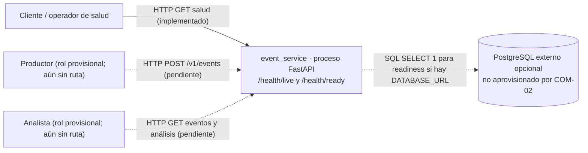

# Contexto — arquitectura implementada (COM-02)

**Estado (2026-10-21):** esqueleto ejecutable del prototipo, no conformidad demostrada con el escenario definitivo. No se recibió enunciado detallado. La aplicación expone únicamente salud; ingesta, consulta y análisis son contratos de trabajo **pendientes de implementar**. Las líneas discontinuas del diagrama son interfaces proyectadas o conexiones condicionales, **no** recursos observados.

| Límite | Responsabilidad actual | Motivo y propiedad |
|---|---|---|
| `event_service` (un proceso, un código fuente) | Componer FastAPI; exponer salud; cargar configuración y construir un engine sin abrir una conexión hasta readiness. | Frontera HTTP mínima sin distribución prematura. No posee todavía registros de eventos. |
| Entorno del proceso | Proveer `DATABASE_URL`, `EVENT_PRODUCER_KEY`, `EVENT_ANALYST_KEY` si se configuran. | Origen externo de configuración, no incluye secretos en Git; las claves no tienen valor por defecto. |
| PostgreSQL (dependencia condicional) | Responder al `SELECT 1` de readiness si está configurado y alcanzable. | La app no aprovisiona PostgreSQL; COM-03 construirá esquema, migración y prueba de persistencia. |

**Flujo existente:** un cliente llama `GET /health/live`; la app responde sin dependencia. En `GET /health/ready`, sin URL responde `503` con error público seguro; con URL, usa SQLAlchemy/psycopg para ejecutar `SELECT 1` y responde `200` o `503`. No se envía URL ni excepción de DB en la respuesta. No hay comunicación asíncrona ni eventos emitidos.

**Flujo MVP propuesto, no actual:** un productor autenticado envía un evento; la entrada valida/autentica, la función de negocio exige permiso y unicidad `(source, external_id)`, el repositorio persiste el original y metadatos, y responde `201` o un error seguro. El analista obtiene un evento o conteos derivados por HTTP. El dueño lógico de `events` y de las reglas de análisis será la capacidad de negocio del servicio (COM-01), mientras el adaptador COM-03 será custodio físico de la tabla. Los conteos son derivados, no una segunda fuente de verdad. COM-04 define validación/errores y COM-05 control de acceso. Nada de esto está operativo en COM-02.

La [vista de contenedores](contenedores.md) enlaza rutas con archivos reales; [despliegue](despliegue.md) distingue el arranque local de los recursos ausentes. Decisiones: [descomposición](../adr/0001-descomposicion.md), [almacenamiento](../adr/0002-almacenamiento.md), [comunicación](../adr/0003-comunicacion.md).
