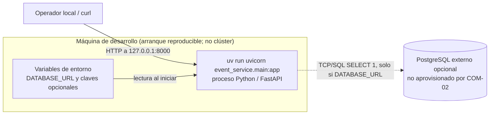

# Despliegue — realidad del esqueleto COM-02

Este diagrama describe **el arranque local posible desde este repositorio**, no un despliegue realizado en un clúster. No existen en este incremento `Dockerfile`, Compose, manifiestos Kubernetes ni Terraform. No se ha creado ni inspeccionado VM Azure, K3s, registro de imágenes o PostgreSQL. El borde discontinuo significa dependencia condicional, no servicio operativo comprobado.



**Para reproducir el arranque:** `uv sync --group dev`, `uv run uvicorn event_service.main:app --host 127.0.0.1 --port 8000`, luego `curl -i http://127.0.0.1:8000/health/live` y `curl -i http://127.0.0.1:8000/health/ready`. Sin URL, la segunda sonda devuelve `503`; no confundirlo con base desplegada o con prueba de durabilidad. `uv run pytest` prueba el esqueleto con DB simulada y sin DB; no sustituye pruebas de recuperación y reinicio de COM-03/04.

**Contraste pendiente del issue #2:** cuando DEV-02/06/09 entreguen imágenes, registro, Azure y manifiestos, inventariar para un commit/ambiente la configuración declarada y la observada (`kubectl get deploy,sts,svc,ingress,pvc,pods -A -o wide`, digests, recursos Azure y registro), sanitizar salidas y trazar `diagrama ↔ manifiesto ↔ recurso observado`. Corregir discrepancias antes de decir que coincide con el despliegue; hoy no hay recursos de esos tipos que comparar. La evidencia de render y revisión de otra persona tampoco se ha producido en este commit.

**Render reproducible de la fuente:** los tres bloques `mermaid` son Markdown renderizable por GitHub. También se comprobaron localmente con Mermaid CLI **11.12.0**; con Node.js y Chromium en Linux, desde la raíz del checkout (el directorio de salida debe existir):

```bash
PUPPETEER_EXECUTABLE_PATH=/usr/bin/chromium PUPPETEER_SKIP_DOWNLOAD=1 npx --yes --package=@mermaid-js/mermaid-cli@11.12.0 mmdc -i docs/arquitectura/contexto.md -o /tmp/opencode/COM-02-contexto-render.md
PUPPETEER_EXECUTABLE_PATH=/usr/bin/chromium PUPPETEER_SKIP_DOWNLOAD=1 npx --yes --package=@mermaid-js/mermaid-cli@11.12.0 mmdc -i docs/arquitectura/contenedores.md -o /tmp/opencode/COM-02-contenedores-render.md
PUPPETEER_EXECUTABLE_PATH=/usr/bin/chromium PUPPETEER_SKIP_DOWNLOAD=1 npx --yes --package=@mermaid-js/mermaid-cli@11.12.0 mmdc -i docs/arquitectura/despliegue.md -o /tmp/opencode/COM-02-despliegue-render.md
```

Cada comando produce un Markdown y un SVG junto a él. Un render correcto acredita sintaxis, **no** correspondencia con un clúster. [Contexto](contexto.md) y [contenedores](contenedores.md) muestran límites y flujos; [ADRs](../adr/0001-descomposicion.md) motivan las elecciones.
