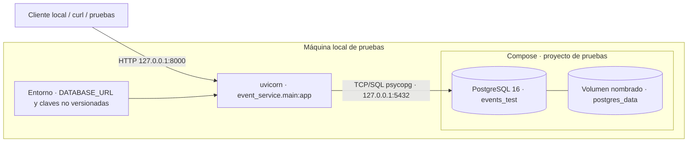

# Despliegue — local verificado; Azure/K3s pendiente (COM-02)

Esta vista describe **solo el entorno local realmente ejecutado** para las pruebas COM-01…05: proceso Python en el host y PostgreSQL 16 en Compose con volumen nombrado. No se ha construido imagen, aprovisionado Azure ni desplegado K3s/registro. No presentar el diagrama local como un clúster.



**Reproducción:** desde checkout limpio, seguir [arranque local](../../README.md#mvp-local-de-ingesta-y-análisis-de-eventos), aplicar Alembic, iniciar API y ejecutar `uv run --locked pytest`. La prueba `scripts/verify_durability.py` escribe por API, reinicia API y PostgreSQL conservando el volumen, vuelve a migrar y lee el mismo evento; las instrucciones de [recuperación](errores.md) detienen/reinician PostgreSQL y verifican `200 → 503 → 200` con **el mismo proceso API**. El volumen local prueba supervivencia ante reinicio, no ante pérdida de VM. Configurar puertos según `POSTGRES_PORT` (el dibujo usa el valor por defecto) y jamás publicar claves.

**Contraste pendiente del issue #2:** cuando DEV-02/06/09 entreguen imágenes, registro, Azure y manifiestos, inventariar configuración declarada y observada (`kubectl get deploy,sts,svc,ingress,pvc,pods -A -o wide`, digests y recursos Azure). Trazar `elemento del diagrama ↔ manifiesto ↔ recurso observado`; entonces reemplazar o extender esta vista con el despliegue real. Aún no existe tal evidencia ni revisión independiente.

**Render reproducible:** los tres Markdown usan bloques `mermaid` renderizables en GitHub. Para volver a verificar sintaxis con Mermaid CLI 11.12.0 y Chromium desde la raíz del checkout (crear el directorio de salida antes):

```bash
mkdir -p /tmp/opencode
PUPPETEER_EXECUTABLE_PATH=/usr/bin/chromium PUPPETEER_SKIP_DOWNLOAD=1 npx --yes --package=@mermaid-js/mermaid-cli@11.12.0 mmdc -i docs/arquitectura/contexto.md -o /tmp/opencode/COM-02-contexto-render.md
PUPPETEER_EXECUTABLE_PATH=/usr/bin/chromium PUPPETEER_SKIP_DOWNLOAD=1 npx --yes --package=@mermaid-js/mermaid-cli@11.12.0 mmdc -i docs/arquitectura/contenedores.md -o /tmp/opencode/COM-02-contenedores-render.md
PUPPETEER_EXECUTABLE_PATH=/usr/bin/chromium PUPPETEER_SKIP_DOWNLOAD=1 npx --yes --package=@mermaid-js/mermaid-cli@11.12.0 mmdc -i docs/arquitectura/despliegue.md -o /tmp/opencode/COM-02-despliegue-render.md
```

Render correcto acredita sintaxis, **no** correspondencia con Azure/K3s. Ver [contexto](contexto.md), [módulos](contenedores.md) y [ADRs](../adr/0001-descomposicion.md).
